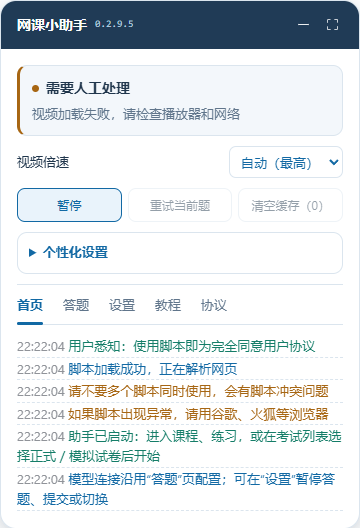

# 网课小助手 · 私有维护版

当前版本 **0.2.9.5**。保留原脚本名称、namespace `noshuang` 和模型存储键，新增站点适配、可选视频倍速、7 项个性化设置和新版悬浮窗。

## 下载与安装

- [完整用户脚本](course-helper.user.js)
- [完整交付包（含说明、验证记录和 0.2.9.4 回退版）](artifacts/网课小助手-0.2.9.5.zip)
- [安装与运行指南](docs/安装与运行指南-0.2.9.5.md)
- [运行约束与异常处理](docs/运行约束与异常处理-0.2.9.5.md)

这是私有仓库，需要登录有权限的 GitHub 账号后下载。更新时优先在油猴管理面板打开原脚本条目，粘贴新版完整内容并保存，以保留原条目的配置。不要依赖未登录的 Raw 链接自动更新。

目标环境为 Windows 上的 Chrome 120+ / Edge 120+ 及 Tampermonkey。原有外部依赖和模型服务仍需联网；浏览器具体权限与安装步骤见指南。

## 本版功能

支持视频页面弹题、题库练习及手动开始后的正式／模拟试卷流程；倍速优先读取播放器，读不到时提供 1×、1.5×、2×。暂停会停止助手和视频，重试受提交状态与接口冷却限制。

| 个性化设置 | 全新配置默认值 | 用途 |
| --- | --- | --- |
| 界面主题 | 跟随系统 | 切换浅色、深色或系统主题 |
| 布局密度 | 舒适 | 调整窗口留白 |
| 文字大小 | 13 px | 调整窗口正文与主要控件 |
| 面板宽度 | 360 px | 设置常规宽度，受视口约束 |
| 不透明度 | 100% | 调整窗口透明程度 |
| 请求间隔 | 5 秒 | 限制自动模型、搜索和图片请求 |
| 操作等待 | 3 秒 | 填选后等待提交或切换；升级继承旧值 |



新增界面及自动请求节奏仅在 `bbgu.jcedutec.cn` 启用。原超星、智慧树处理逻辑保持原样。脚本不保证模型答案正确或网站永不判异常；验证码、身份验证、签名和登录由用户处理，不伪造课程记录。

## 源码与构建

`src/` 包含保留的原脚本、适配模块和构建器。Node.js 20+ 可直接构建，无需安装 npm 包：

```sh
node src/build-adaptation.cjs
node --check course-helper.user.js
```

构建器只替换原脚本的指定位置，并输出根目录的 `course-helper.user.js`。仓库源码没有包含真实模型 Key、浏览器会话、个人配置或完整站点抓取 fixture。

## 验证与回退

本地 **109 项检查通过，0 失败、0 跳过**，包含原有 95 项检查及新增 14 项；实测使用隔离 Edge 157.0.4341.42 和模拟的模型／后台响应。[验证报告](docs/验证报告-0.2.9.5.md)、[原始检查记录](verification/检查记录-0.2.9.5.txt)、[结构化记录](verification/verification-0.2.9.5.json) 已保留。

这些是本地验收记录。完整浏览器测试用到的站点捕获 fixture 和已登录浏览器环境未上传，不能仅凭本仓库文件重跑全部实站相关组件检查。

当前电脑上的油猴安装与真实账户流程尚未确认，见[安装状态](docs/安装状态-0.2.9.5.md)。记录中的 localhost 安装链接只适用于原电脑的服务会话，从 GitHub 安装请使用上面的下载与编辑器更新步骤。

- [0.2.9.4 回退脚本](rollback/0.2.9.4/course-helper.user.js)
- [0.2.9.0 回退脚本](rollback/0.2.9.0/coursepilot-ai.jcedutec.user.js)
- [当前仓库文件校验和](SHA256SUMS.txt)

原始脚本及本次改动保留 MIT 授权和原作者署名，见 [LICENSE](LICENSE)。
