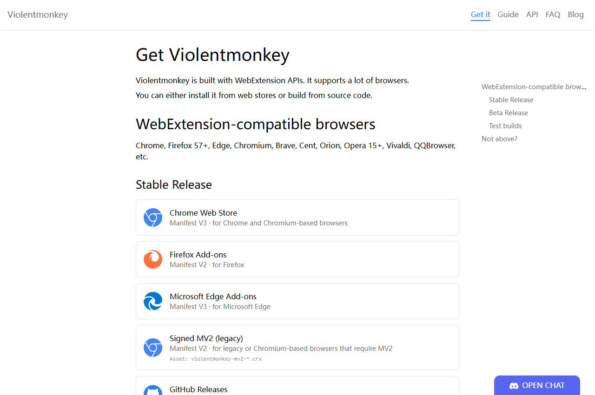
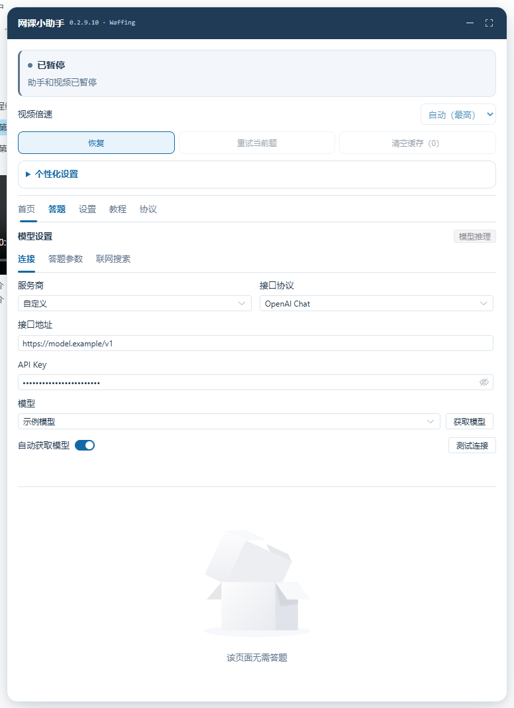
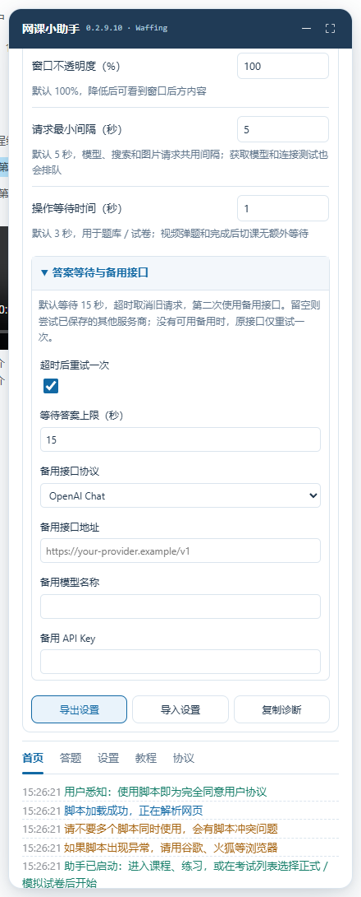
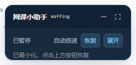
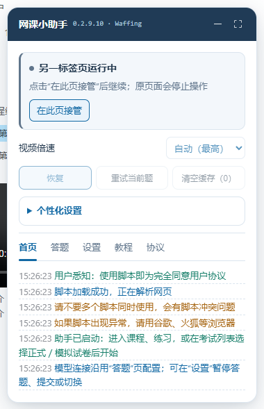
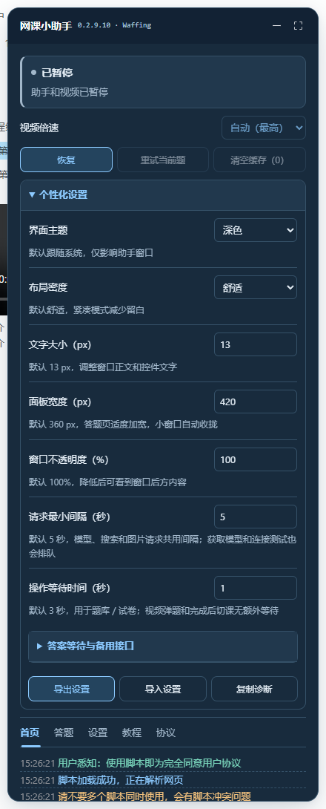
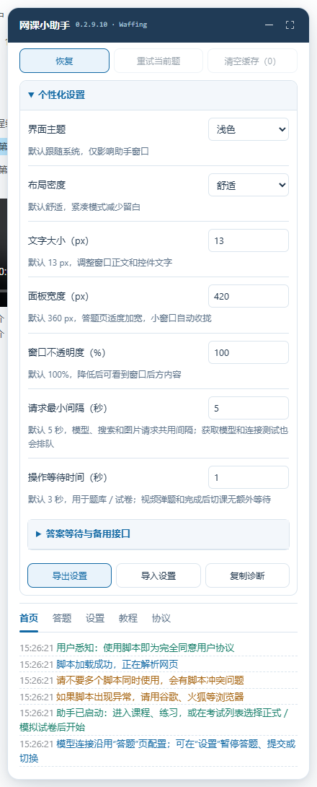

# 从零开始：安装暴力猴，使用网课小助手

适合第一次使用用户脚本的 Windows 用户。建议使用近期版本的 **Microsoft Edge 或 Google Chrome**；兼容目标为 120+。脚本是 `.user.js` 文件，需要通过暴力猴这类脚本管理器运行。

本文助手配图（1–6、8）来自 **0.2.9.10 实际脚本的隔离演示页面**，模型、用户与课程内容均为测试数据；第 7 张是暴力猴官方下载页。图片展示操作位置，不代表真实账户验收。

## 1. 安装暴力猴

1. 用你平时上课的浏览器打开 [暴力猴官方下载页](https://violentmonkey.github.io/get-it/)。
2. Edge 用户选择 **Microsoft Edge Add-ons**；Chrome 用户选择 **Chrome Web Store**，在商店点击“获取”或“添加至 Chrome”，确认“添加扩展”。以官网当时提供的稳定版入口为准。
3. 点击浏览器右上角的“扩展”拼图图标，把 **Violentmonkey / 暴力猴**固定到工具栏。
4. 如果扩展提示需要启用“允许用户脚本”或开发者模式，打开 `edge://extensions/` 或 `chrome://extensions/`，进入暴力猴的详细信息，按扩展提示开启对应权限。不同版本的开关名称可能不同。

已经用油猴安装过本脚本：先在原管理器更新原条目，可以保留模型 Key 和设置。**不要让暴力猴和油猴同时运行两份相同脚本。** 两个管理器之间不会自动共享配置；如要迁移，先从旧脚本导出设置，再关闭旧条目，在新管理器安装后导入并重新填写 Key。

## 2. 安装网课小助手

1. 安装好暴力猴后，点击 **[安装 0.2.9.10 脚本](https://raw.githubusercontent.com/Waffing/CoursePilot-AI-Private/v0.2.9.10/course-helper.user.js)**。
2. 通常会打开暴力猴安装确认页。核对脚本名称是“超星学习通｜知到智慧树--网课小助手【大模型版】”，版本为 **0.2.9.10**，然后点击“安装”。
3. 点击暴力猴图标 → 管理面板，确认脚本已启用。
4. 刷新已打开的课程网页。新增适配站点包括 `bbgu.jcedutec.cn`、`wisdom-mooc.zhihuishu.com` 和 `onlineexamh5new.zhihuishu.com`；脚本不会在普通搜索或 GitHub 页面显示。

**如果链接只显示一大段代码或下载了文件：**

1. 在 GitHub 打开 [0.2.9.10 完整脚本](https://github.com/Waffing/CoursePilot-AI-Private/blob/v0.2.9.10/course-helper.user.js)，点击 **Raw**。按 `Ctrl+A`、`Ctrl+C` 复制全部内容。
2. 暴力猴图标 → **“＋” / 新建脚本**。在编辑器按 `Ctrl+A`，粘贴完整脚本，再按 `Ctrl+S` 保存。
3. 回到管理面板，确认名称、版本和启用状态，再刷新课程页面。若已经安装过，请直接打开原条目编辑，不要重复新建。

不要双击 `.js` 文件交给 Windows 脚本宿主执行。安装只在浏览器中完成。

## 3. 第一次配置模型

打开课程页后，先点助手里的 **“暂停”**，再切到 **“答题”** 标签。

| 项目 | 怎么填 |
| --- | --- |
| 服务商 | 选择你实际使用的模型服务；兼容接口通常选“自定义” |
| 接口协议 | 按服务商文档选择 OpenAI Chat、Responses、Anthropic 或 Gemini |
| 接口地址 | 填服务商提供的 API 基础地址；图片中的 `https://model.example/v1` 只是示例，不能调用 |
| API Key | 填你自己的模型密钥；这不是学校账号密码，也不是聊天网站的登录密码 |
| 模型 | 点击“获取模型”选择，或按服务商要求填写准确名称；图片题需要支持图片的模型 |

点击 **“测试连接”**。出现连接成功说明接口可用；它不保证答案正确。获取模型、测试连接和自动查询会共用请求队列，显示等待秒数时等候即可。

模型服务通常需要你自行开通，可能产生调用费用。Key 仅通过脚本管理器的配置保存，不包含在本仓库、设置导出或示例截图里。不要把密钥输入到学校登录框，也不要随截图公开。

### 避免一直停在“搜索答案”

展开“个性化设置” → **“答案等待与备用接口”**：

1. “等待答案上限”默认为 **15 秒**，可调 5–120 秒。
2. 填写备用接口协议、地址、模型名称及其自己的 Key。可以使用另一家服务，也可以用同一服务的另一个模型。备用 Key 使用独立管理器存储键，不写入设置导出。
3. 自动查询超时后会取消旧请求，第二次切换到该备用模型；两次均失败则停下，提供人工重试入口，不无限循环。
4. 备用地址和模型留空时，会尝试已保存的其他服务商配置；没有其他可用配置时，只重试当前模型一次。关闭“超时后重试一次”即可只查询一次。
5. 这会重新请求模型答案，不会把已发送的网站提交再发一次。验证码、暂停、题目变化和标签页接管都会取消重试。

等待上限针对自动答案查询；请求队列、接口冷却和题目图片加载分别显示状态，不靠重复刷新绕过限速。连接测试沿用模型设置里的连接超时。

## 4. 开始日常使用

智慧树新版用户请同时阅读 [智慧树使用说明](智慧树使用说明.md)。它的课程、随堂题和独立作业／考试已新增适配，倍速最高只选网站允许且不超过 1.8× 的原生档位。

1. 正常登录课程网站，手动进入你要看的课程或练习。
2. 在“设置”里确认自动播放、答题、提交与切课开关。默认开启，旧版本升级会继承已有值。
3. 点击 **“恢复”**。视频倍速可选择自动最高档，也可手动选播放器提供的档位；无法识别时提供 1×、1.5×、2×。
4. 留意顶部状态。模型答案能唯一对应选项且选中状态核对通过后，视频弹题立即提交；练习和试卷遵循操作等待设置。网站是否接受提交单独显示。
5. 离开时点“暂停”，助手和视频一起停止。再次点“恢复”继续。

课程自然播放结束、网站确认保存后才切下一视频；没有伪造进度或跳过服务器确认。脚本不会自己挑选试卷或开始考试。验证码、身份验证、签名和登录需要你处理；无法识别的题型也会停下。

## 5. 用起来更方便的几个按钮

| 功能 | 用法 |
| --- | --- |
| 最小化 | 点标题栏“－”；迷你条仍保留状态、倍速和暂停／恢复，点“展开”恢复完整面板 |
| 在此页接管 | 同一站点只保留一个运行页面；第二个标签页等待，接管后旧页面停止助手操作 |
| 重试当前题 | 查询或填选失败、冷却结束后使用；提交已发出但结果不明确时不会补发 |
| 清空缓存 | 清除本页最近 100 道文字题答案缓存；图片题不缓存 |
| 检查模型配置 | 遇到模型鉴权或接口问题时直接打开模型设置 |
| 答题历史分页 | 超过 100 条后分页显示；“最新”返回最近记录，历史记录和防重状态继续保留 |

多标签页协调范围是 **相同浏览器配置文件、相同网站来源**。不同浏览器、端口、无痕窗口、脚本管理器或电脑不能可靠互相协调。手动接管不会把页面跳到旧页面的题目位置。

## 6. 个性化、备份和诊断

展开 **“个性化设置”**，更改即时保存。

| 设置 | 全新安装默认值 | 用途 |
| --- | --- | --- |
| 界面主题 | 跟随系统 | 浅色、深色、系统主题 |
| 布局密度 | 舒适 | 紧凑模式减少留白 |
| 文字大小 | 13 px | 可调 12–18 px |
| 面板宽度 | 360 px | 可调 300–560 px，答题页自动加宽并受屏幕约束 |
| 窗口不透明度 | 100% | 可调 80–100% |
| 请求最小间隔 | 5 秒 | 模型、搜索、图片、获取模型及连接测试的起始间隔 |
| 操作等待时间 | 3 秒 | 练习／试卷的操作等待；视频弹题及确认完成后的切课无额外固定等待 |

旧安装会继承已有设置，因此实际数值可能不同于上表。

设置区域底部提供：

- **导出设置**：下载 JSON 备份，保留界面、倍速和基础模型设置，排除 Key、搜索凭据、自定义提示词、登录信息，以及接口地址中的用户名、查询参数和片段。
- **导入设置**：先展示将修改哪些项目，再由你确认。导入后助手保持暂停，Key 不从文件导入。已有 Key 时，跨服务商或跨域接口配置会被拒绝，避免把原 Key 发给不同服务。
- **复制诊断**：复制最近 20 条经过脱敏的日志和基本状态。复制不成功时会出现文本框，可以手动 `Ctrl+C`。发送前检查内容；不要把完整管理器配置或浏览器登录数据贴到 Issues。

## 7. 更新与回退

脚本已经关联 [Waffing 的 GitHub 仓库](https://github.com/Waffing/CoursePilot-AI-Private)。版本信息来自 `course-helper.meta.js`，完整脚本来自 `course-helper.user.js`；不再加载旧公告。

1. 已有旧版：先在原脚本条目粘贴 **0.2.9.10** 完整内容并保存，或打开安装直链完成一次更新。核对作者为 **Waffing**，名称和 namespace 与原条目一致。
2. 打开暴力猴管理面板 → 设置，确认脚本的自动更新已开启；更新检查频率按你的管理器设置执行。脚本条目的更新设置中若手动指定过其他更新地址，请恢复使用脚本中的 GitHub 地址。
3. 需要立即检查时，在管理面板使用“检查更新”功能。联网可访问 GitHub Raw 且仓库发布更高版本时，管理器才会下载更新；同版本不会反复安装。
4. 更新后刷新课程页，新版开始运行。模型 Key 和个人配置保留在原管理器条目；不要先删除原条目。
5. GitHub Raw 暂时不可访问时，仍可手动打开原条目，用最新版完整内容替换、`Ctrl+S` 保存，再刷新页面。

更新来源为你的仓库 `main` 分支。更新由暴力猴／油猴处理，脚本不会另外轮询或自动执行下载代码。具体设置名称以管理器版本为准，暴力猴更新行为参考 [官方元数据说明](https://violentmonkey.github.io/api/metadata-block/#downloadurl)。

更新前可先“导出设置”。出现兼容问题时，暂停助手，在原条目粘贴 [0.2.9.9 回退版](../rollback/0.2.9.9/course-helper.user.js)，保存并刷新。不要删除原条目后再安装，以免丢失原管理器内的密钥。

## 8. 常见问题

| 现象 | 处理方法 |
| --- | --- |
| 没有悬浮窗 | 确认脚本启用且网址匹配；刷新课程页；检查暴力猴权限和外部依赖是否加载；不要只在 GitHub 页面找窗口 |
| Raw 页面打不开 | 等网络恢复，或从 GitHub 文件页下载／复制完整脚本，再用编辑器安装；不要复制 README 当脚本 |
| “另一标签页运行中” | 找到正在运行的页面，或在当前页面点“在此页接管” |
| 401／403、鉴权失败 | 检查 Key、接口、模型权限，点“检查模型配置”；修正后测试连接，再按需重试当前题 |
| 429／请求冷却 | 按显示的倒计时等待；可增大请求间隔，避免反复点测试或重试 |
| 没有模型列表 | 核对接口协议和地址；服务不支持列出模型时，关闭自动获取并手动填准确名称 |
| 视频不能自动播放 | 使用网站播放器手动点一次播放，之后再观察；网络或浏览器策略可能阻止自动播放 |
| 选了答案但未提交 | 查看自动提交开关、操作等待、是否手动改过选项，以及网站按钮是否可用 |
| 已发出提交但“尚未确认” | 在网站核对结果；助手保留提交记录并停止补发，刷新或接管也不会主动重发该记录 |
| 验证码或重新登录 | 手动完成验证，再检查当前页面状态；不要连续刷新或反复提交 |

## 功能与验证边界

新增界面和协调机制支持实验室安全学习系统及智慧树新版课程／作业考试页面。选择题重点支持单选、多选和判断，试卷由用户自己选卷并开始。其他超星与智慧树旧页面继续使用原有处理逻辑；加密文字、不可读题干及其他未适配题型留给人工处理。

脚本依赖外部框架 CDN、模型服务和网站本身的网络响应，不承诺消除缓冲、浏览器后台节流、平台检测或错误答案。完整验收结果见 [验证报告](验证报告-0.2.9.10.md)；隔离浏览器测试与真实账号、已安装暴力猴环境的验收分别说明。

官方参考：[暴力猴下载入口](https://violentmonkey.github.io/get-it/)、[暴力猴创建脚本指南](https://violentmonkey.github.io/guide/creating-a-userscript/)。入口与按钮名称以官方当前页面为准。
