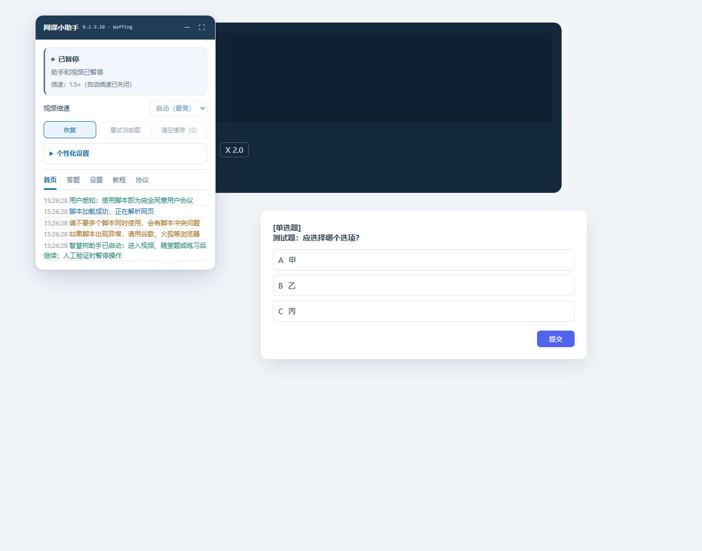
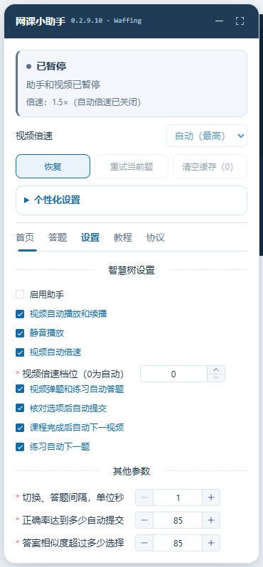

# 智慧树新版适配 · 0.2.9.10

新增适配 `wisdom-mooc.zhihuishu.com/study/index`，以及课程“作业考试”实际跳转的 `onlineexamh5new.zhihuishu.com/stuExamWeb.html`。模型配置、Waffing 署名、GitHub 更新、暂停和 15 秒超时机制继续沿用。

## 开始使用

1. 在暴力猴／油猴中更新原脚本条目到 **0.2.9.10**，保留原有模型 Key 和设置。先确认只启用一份脚本。
2. 刷新智慧慕课课程页，助手标题为“网课小助手”。在“答题”检查模型连接；在“设置”查看独立的“智慧树设置”。
3. 正常进入视频并点击“恢复”。视频由网站原播放器播放，助手不修改进度、计时或验证结果。
4. 视频弹出随堂题时，助手读取当前题干、选项和支持的图片，通过配置的模型查询，核对选中状态后点击网站原生提交。
5. 需要做练习或考试时，由你自己打开相应入口并开始。助手不会选卷、启动新考试、勾选诚信协议或处理人脸／验证码。

## 视频和倍速

当前公开页面代码会在播放速度超过 **1.8×** 时停止播放并跳出，因此本适配只选择不超过该限制的原生档位。常见可用档位为 **1× / 1.25× / 1.5×**；自动模式选择实际可用的最高档。

只有视频自然播放结束、网站原生保存请求成功确认后，才点击播放器“下一视频”。等待保存超过 15 秒会提示尚未确认；没有成功回执时不快进、不伪造或补发进度请求。

## 随堂题、练习和考试

| 页面 | 当前适配行为 |
| --- | --- |
| 智慧慕课视频随堂题 | 支持单选、多选、判断；一组弹题全部填选核对后提交一次 |
| 智慧慕课 `/exam` 练习 | 使用原生选项，按操作等待进入下一题；答题卡与已处理记录均完整后才提交本轮 |
| 独立系统作业／考试 | 用户手动进入已开始的 `dohomework`／`doexamination` 页面后处理可读的选择题；逐题点击原生下一题／保存并等待成功；整卷网站状态和助手保存记录均完整后才处理原生交卷确认 |
| 验证、加密文字、复合题、其他题型 | 停止并留给人工处理；不绕过网页校验、计时、字体加密、验证码或身份验证 |

随堂题保留文字答案缓存，同样的题型、题干和选项顺序才会复用；图片题不缓存。网站显式答错反馈使相关缓存失效。

所有模型查询遵守请求间隔。答案默认等待 15 秒，超时取消旧查询并尝试一个备用模型，最多两次；两次失败停止。保存与提交的结果不明确时不自动重复发送。

## 独立设置与暂停

智慧树启用、播放、静音、倍速、答题、提交、切视频和下一题开关独立于其他网站。个性化外观和模型配置继续共享；新导出的设置备份会标记所属平台，避免把另一网站的开关误导入。

暂停会停止视频及后续助手操作。浏览器缓存挂起、返回页面、多标签页接管使用与现有助手相同的生命周期保护。不同网站来源的标签页属于不同协调范围，不能跨来源可靠互相接管。

## 界面演示

以下为真实助手渲染在**模拟智慧树 DOM**中的演示，使用测试模型和虚构题目，不包含真实课程或账户数据，不代表已登录实站验收。

## 验证范围

本轮根据提供链接的公开页面、动态模块、播放器和独立考试系统资源确认页面结构及原生保存流程。本地测试模拟选项状态、学习回执和模型响应；测试不使用真实模型 Key，也不向真实课程或考试发送学习／答题记录。

**尚未完成**：当前登录 Edge 的现场安装、真实模型连接、真实视频弹题、长视频自然完成后的真实切课及真实作业／考试保存。电脑控制工具因无法可靠确认当前浏览器网址而终止了 Edge 接管，因此不能将本地检查等同于实站完成。

有些考试的题干会被字体加密或封装在不可读区域。助手不会将不完整或乱码内容发送给模型，应按页面提示人工完成。后续网站更新也可能改变页面结构，若助手停住，可先暂停并复制脱敏诊断。
